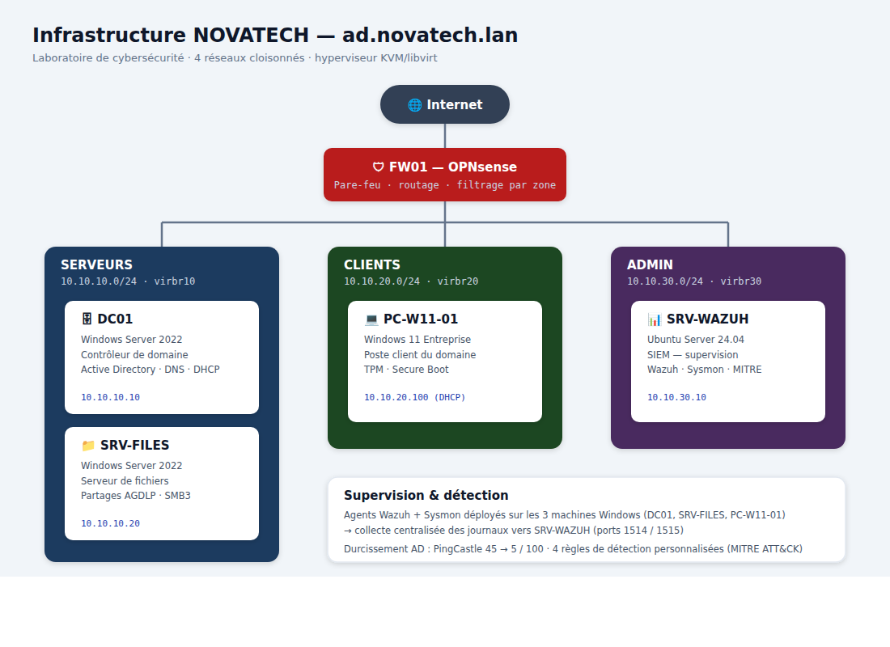

# 🛡️ Infrastructure Windows Server sécurisée et supervisée

> Laboratoire de cybersécurité défensive (*blue team*) — conception,
> durcissement, supervision et détection d'attaques sur un environnement
> Active Directory d'entreprise entièrement virtualisé.


---

## 📌 En bref

Ce projet reproduit le système d'information d'une PME fictive (**NOVATECH**)
et applique une démarche complète de sécurité défensive, en quatre temps :

> **Construire → Durcir → Superviser → Détecter**

| Indicateur | Résultat |
|---|---|
| Score de risque Active Directory (PingCastle) | **45 → 5 / 100** |
| Machines supervisées (Wazuh + Sysmon) | **3** |
| Règles de détection personnalisées (MITRE ATT&CK) | **4** |
| Détection d'attaque validée de bout en bout | ✅ |

---

## 🗺️ Architecture

Quatre réseaux logiques isolés, séparés par un pare-feu OPNsense.



**Domaine :** `ad.novatech.lan` (NOVATECH)

| VM | Système | Rôle |
|---|---|---|
| FW01-OPNsense | OPNsense 26.7 | Pare-feu, routage inter-réseaux, règles par zone |
| DC01 | Windows Server 2022 | Contrôleur de domaine, DNS, DHCP |
| SRV-FILES | Windows Server 2022 | Serveur de fichiers (partages AGDLP, SMB3) |
| PC-W11-01 | Windows 11 Entreprise | Poste client du domaine |
| SRV-WAZUH | Ubuntu Server 24.04 | SIEM Wazuh (supervision & détection) |

*Hyperviseur : KVM / libvirt sur hôte Ubuntu.*

---

## 🔧 Technologies

**Infrastructure :** KVM/libvirt · OPNsense · Windows Server 2022 · Windows 11 · Ubuntu Server
**Active Directory :** ADDS · DNS · DHCP · GPO · modèle AGDLP · Windows LAPS
**Sécurité & audit :** PingCastle · CIS Benchmark · recommandations ANSSI
**Supervision & détection :** Wazuh (SIEM) · Sysmon · MITRE ATT&CK
**Automatisation :** PowerShell

---

## 📂 Contenu du dépôt

```
projet-infra-securisee/
├── README.md                → ce fichier
├── scripts/                 → scripts PowerShell d'automatisation
│   ├── 01-Structure-AD.ps1       (OU, utilisateurs, groupes globaux)
│   ├── 02-Groupes-AGDLP.ps1      (groupes de domaine local)
│   ├── 03-Partages.ps1           (serveur de fichiers, permissions)
│   ├── 04-Durcissement-AD.ps1    (quota, délégation, politiques)
│   ├── 05-GPO-Securite.ps1       (GPO durcissement + audit)
│   ├── 06-LAPS.ps1               (mots de passe admin locaux)
│   └── 07-Sysmon-Wazuh.ps1       (agent + Sysmon)
├── regles-wazuh/
│   └── local_rules.xml           (règles de détection MITRE ATT&CK)
├── docs/
│   ├── journal.md                → journal de bord détaillé
│   └── architecture.png          → schéma d'architecture
└── captures/                → captures d'écran (01 à 50)
```

---

## 🧱 Les quatre phases

### 0 — Socle réseau
Hyperviseur KVM, **4 réseaux cloisonnés**, pare-feu OPNsense avec règles de
filtrage par zone (chaque réseau ne communique qu'à travers le pare-feu).

### 1 — Infrastructure Windows
Forêt Active Directory `ad.novatech.lan`, **11 utilisateurs** organisés en OU
par service, DNS, DHCP, serveur de fichiers avec permissions selon le modèle
**AGDLP**, poste client joint au domaine.

### 2 — Durcissement & audit
GPO de sécurité (NTLMv2, LLMNR désactivé, journalisation PowerShell), audit
avancé, **Windows LAPS**, politique de mots de passe renforcée,
`MachineAccountQuota=0`, corbeille AD.
➡️ **Score PingCastle : 45 → 5/100.**

### 3 — Supervision & détection
SIEM **Wazuh** + **Sysmon** sur les 3 machines Windows, collecte centralisée,
**4 règles de détection personnalisées** cartographiées MITRE ATT&CK, détection
d'une attaque validée de bout en bout.

---

## 🎯 Détection — règles personnalisées

| Règle | Détecte | MITRE ATT&CK |
|---|---|---|
| `100100` | Mauvais mot de passe Kerberos (échec de pré-auth) | T1110 |
| `100101` | Password spraying via Kerberos (multi-comptes, même source) | T1110.003 |
| `100102` | Password spraying via ouverture de session (NTLM/SMB) | T1110.003 |
| `100110` | Kerberoasting (ticket de service RC4) | T1558.003 |

**Validation :** une authentification échouée réelle a déclenché la règle
`100100` sur le tableau de bord Wazuh, avec IP source, compte visé et technique
MITRE.

---

## 📈 Résultat clé

```
Score de risque du domaine Active Directory (PingCastle)

État initial   ████████████████████████████████████████████▌  45 / 100
État final     ████▌                                            5 / 100
                                              (plus bas = plus sûr)
```

---

## 🚀 Perspectives

- Démonstration offensive contrôlée (Atomic Red Team) pour éprouver les règles
- Alignement sur le benchmark CIS (SCA : 27 % → cible supérieure)
- Second contrôleur de domaine, PKI interne, WSUS, sauvegardes

---

## 👤 Auteur

**Fadyl** — Étudiant en Master Cybersécurité
🔎 À la recherche d'une alternance ou d'un stage alterné.

> Projet personnel de laboratoire, mené de bout en bout à des fins
> d'apprentissage. Toutes les manipulations offensives sont réalisées
> exclusivement dans cet environnement isolé.
